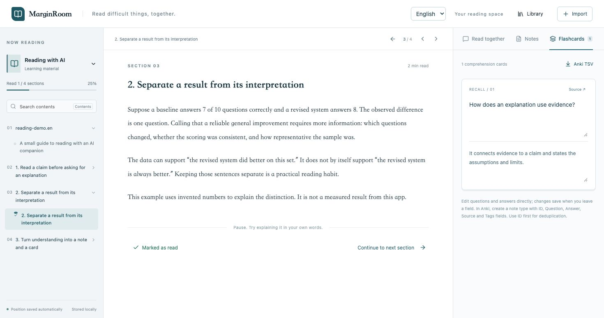

# MarginRoom · 阅间

**Read difficult material with an AI companion beside the text.**

[English](README.md) · [简体中文](README.zh-CN.md)

Import a technical book, tutorial, or paper. Select a passage, ask about it, check the cited section, then keep a note or an editable flashcard. MarginRoom keeps that conversation connected to what you are reading.

> Early preview. Runs on your computer. AI answers require your own **DeepSeek API key and API balance**. Relevant text and conversation history are sent to DeepSeek; this is not an offline model.



## Start locally

Requirements: **Python 3.12+, [uv](https://docs.astral.sh/uv/getting-started/installation/), Node.js 22.12+ and npm**. The convenience script is for macOS/Linux; the manual commands also work in a suitable Windows shell.

```sh
git clone https://github.com/wanghao-SunSky/MarginRoom.git
cd MarginRoom
uv sync
uv run python scripts/configure_key.py
cd web
npm ci
npm run build
cd ..
uv run uvicorn backend.app:app --host 127.0.0.1 --port 8765
```

Open **http://127.0.0.1:8765**. Key entry is hidden and saved to the ignored server `.env`; it is never put in the frontend. Obtain a key from [DeepSeek's official platform](https://platform.deepseek.com/). You can browse the included original examples and write notes without a key; AI requests need a valid key.

After setup, `./scripts/start.sh` builds missing frontend assets and starts the server. After changing frontend code, run `npm run build` inside `web` again. The default model is `deepseek-flash`; `DEEPSEEK_MODEL` in `.env` controls the requested model name. Availability and charges depend on your DeepSeek account.

## Try this reading flow

1. Open **Reading with AI** or import your own PDF, Markdown, or UTF-8 TXT.
2. Select a sentence and ask “What does this mean?” The current section and your selection accompany the question.
3. Ask “Read this chapter and summarize its problem and main idea.” The agent can read sections/chapters, search the book, and retrieve this book's previous conversations.
4. Follow a source citation, or ask to jump to another section. **Return to reading position** returns to the previous section.
5. Save a note or ask for review cards. Edit the cards, then export **Anki TSV**.

Switch **English / 中文** in the header. This changes the interface, quick questions, and the requested language of new AI replies. Imported books and existing notes/conversations keep their original language.

## What is included

- Position-aware questions and section citations; requested navigation with page acknowledgements.
- Notes, chapter summaries, reading reviews, raw conversation history, and search within the current book.
- Editable review cards, Markdown notes export, and Anki TSV export.
- Streaming answers that stop following when you click the chat or scroll upward; **Jump to latest** resumes.
- Cancellation, timeouts, bounded tool calls, and explicit failures for incomplete responses.
- Local SQLite storage and original bilingual sample material.

The reader uses React/TypeScript; a local FastAPI service runs the agent and stores data in SQLite. The model has reading/search/navigation/save tools. Final expression forms help it distinguish a definition, a follow-up explanation, a chapter overview, and a requested full walkthrough. There is no separate model call just to rewrite the final response. See [architecture](docs/architecture.md).

## Limits worth knowing

| Area | Current behavior |
|---|---|
| Files | PDF, Markdown, UTF-8 TXT; 20 MB per file, 600 PDF pages maximum. No EPUB. |
| PDFs | Text extraction by page; original-page view available. No OCR or image/diagram understanding. Columns, formulas, and tables may extract incorrectly. “Chapter” for PDF follows the available extracted range, not a recognized table of contents. |
| Answers | Models can be wrong or overgeneralize. A valid citation identifies a source section; it does not prove that every claim follows from it. Reading budgets may limit coverage. |
| Search | Keyword search and explicit reading tools; no embedding index. |
| Review | Anki TSV, not `.apkg` or AnkiConnect. No built-in spaced repetition. Read marks do not prove understanding. |
| Hosting | Single-user localhost app without authentication. Do not expose it to a public network as a hosted service. |

## Data and privacy

Books, notes, cards, and conversations are stored under `data/`. For AI questions, the book title, current section (up to 16,000 characters), selection (up to 5,000 characters), question, up to 12 recent messages (up to 5,000 characters each), and any material fetched by the agent are sent to the **official DeepSeek API**. The key stays on the server. This project adds no analytics or background telemetry.

Stop the server before backing up `data/`; keep `.env` separately and privately. Do not commit either. The repository contains original sample texts, not your imported books, local study library, or conversations. See [security and privacy](SECURITY.md).

## Import cards into Anki

Create a note type with five fields in this order: **ID, Question, Answer, Source, Tags**. Import the TSV with HTML enabled and use ID as the first field for duplicate detection. Suggested templates:

```html
<!-- Front -->
{{Question}}
<!-- Back -->
{{FrontSide}}<hr id="answer">{{Answer}}<br>{{Source}}
```

Source links point to your local MarginRoom server and require it to be running. The app exports drafts; review their accuracy before studying them.

## Development and feedback

```sh
uv run pytest -q
cd web
npm test
npm run build
```

For frontend development, run the backend and `npm run dev` in `web` (Vite proxies `/api` to port 8765).

Please [open an issue](https://github.com/wanghao-SunSky/MarginRoom/issues) with steps to reproduce, expected/actual behavior, browser/OS, and a small non-private sample when relevant. Do not upload keys, private books, or full personal conversation databases. [Contributing](CONTRIBUTING.md).

[MIT License](LICENSE). Third-party libraries retain their own licenses. Early preview: tested workflows are documented in [release checks](docs/release-checks.md); this is not a claim of being bug-free.
