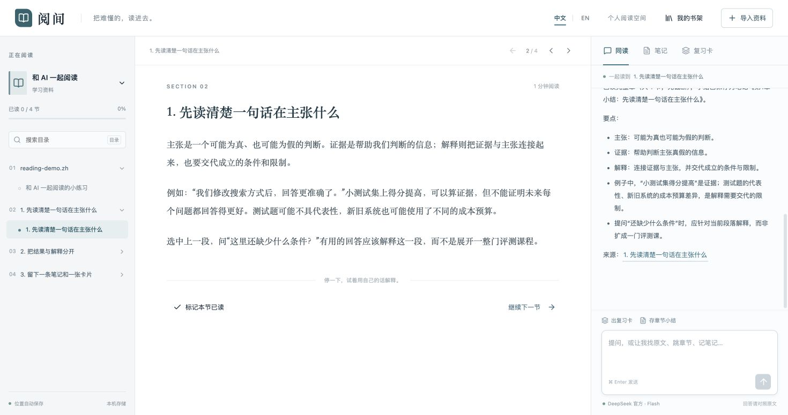

# 阅间 · MarginRoom

**AI 时代的读书工具 —— 从第一行代码起就为共读而生的 AI-Native 阅读空间。**

[English](README.md) · [简体中文](README.zh-CN.md) · **[在线免费开始 (marginroom.app)](https://marginroom.app)**

读一本硬书、长论文或系统教程时，最打断心流的从来不是“字不认识”，而是**上下文断了**：读到第 5 章突然冒出第 2 章定义的符号；看懂了局部推导，却忘了这一章到底在解决什么问题；好不容易啃下一节，合上书又只剩模糊印象。只把聊天框挂在文档侧边很难消解这种割裂——你往往还是得自己来回翻目录、复制粘贴段落、手动给 AI 拼凑背景。

在 **阅间（MarginRoom）** 里，Agent 真正住进了阅读器里，陪你坐在书页旁：
- **自动同步当前小节与划选内容**：当前打开哪一节、哪一页 PDF、鼠标圈出了哪段话，提问时自动带上，无需复制粘贴。
- **它能自己翻遍整本书**：能看全书目录、跨章节检索关键词、按需调阅任意小节或整章原文，还能翻出你们三天前在这本书里的讨论记录。
- **它能直接操作你的阅读视图**：一句“带我去前面定义这个概念的地方”，它就会把你的书页直接翻过去，等页面确认到位后再结合上下文给你讲透；看完点一下，立刻回到刚才读到的位置。
- **读完一节，顺手拆成笔记与 Anki 卡片**：刚啃下来的硬骨头，当场让它提炼成带原文定位的笔记，或拆成检验理解的 Anki 问答卡，核对润色后直接导出复习。



---

## 一段真实的共读现场

想象你正在读一本系统设计专著或机器学习教材，读到半途卡在了一段推导上：

1. **划选即问，直奔卡点**  
   圈出卡住的那句话，点击浮现的「解释这段」，或者直接问：*“为什么这里突然要求这个假设？”* Agent 已经拿着你当前所在的小节原文与划线句子，围绕你眼前的段落和书中的例子展开解释，并附上可点击核对的章节引用，省去手动贴背景的周折。

2. **跨章追根溯源，直接带你跳过去**  
   你接着追问：*“作者在前面哪一节正式定义过这个边界条件？带我过去对照看一下。”*  
   Agent 会自己检索全书、读取目标小节核对，然后**直接驱动你的阅读器跳转到对应章节或 PDF 页码**。阅读器切换并回执确认后，它会指着那里的原文把前因后果串起来。对照读完，点击工具栏的 **「返回阅读位置」** （或直接让 Agent 带你回去），一秒回到刚才中断的地方继续往下读。

3. **全局视野与进度对齐**  
   迷失在细节里时，问一句：*“读一下这一章，告诉我它到底在解决什么核心问题？”* 或者 *“看看目录，这一节和后面的内容是什么关系？”* Agent 会调取整章内容或全书大纲为你梳理全局脉络。每读完一节打上**已读标记**，当你阶段性复盘时，它可以查看你的已读进度、历史笔记与过往提问，整理出一份基于真实记录的**学习回顾**——汇总已读章节、既有笔记与讨论过的重点，方便你对照核查哪些疑问还没闭环、下一步该看哪里。

4. **把读懂的东西留下来，拆成 Anki 卡片**  
   真正读通一节后，点一下 **「出复习卡」**，或对它说：*“把这一节最关键的机制拆成 4 张 Anki 卡片，考理解，别只考名词解释。”*  
   Agent 整理完成后，右侧「复习卡」面板会生成一组一问一答的卡片草稿：你可以先自己默想、点击翻开答案自测，也可以直接在卡片上修改措辞（失焦自动保存），每张卡片都带着一键跳回原文的锚点。攒够一章，导出 **Anki TSV** 文件导入 Anki，或导出带原文链接的 **Markdown 笔记**。

---

## 为什么说它是 AI-Native 阅读工作台

阅间把阅读、检索、跳页定位与卡片沉淀放在同一个闭环视图里，围绕**人类如何真正读懂一本难书**来设计工作方式：

- **三栏一体的沉浸工作台**：左侧是展示手动已读进度的章节目录与检索栏；中间是排版考究的沉浸式书页（支持 Markdown 数学公式与代码块排版，PDF 支持**原版版面与提取文本一键切换**，默认开启读到小节底部继续下滚翻入下一节，划选文字时暂停翻页，也可在顶部随时关闭）；右侧是同读对话、笔记归档与复习卡面板。中英文界面与 AI 回复语言可通过顶部 `中文 | EN` 随时切换。
- **过程透明，章节引用可一键点回书页核对**：Agent 的每次检索、读章、查历史都会在消息上方留下可展开的「过程记录」。共读提示词引导模型将原文依据与补充推导分开陈述，并且回答中指向当前书籍真实小节的 `[章节标题]` 引用会被校验并渲染为可点击按钮，点一下即可跳回对应书页对照原文。
- **对长回复友好的阅读节奏**：流式输出回答时，只要你点击对话区或向上滚动回看，自动滚屏就会立刻安静停下，不会抢夺你的视线；准备好继续时，点一下「回到最新」即可。

---

## 开始使用（在线即用或本地部署）

- **在线服务（[marginroom.app](https://marginroom.app)）**：打开网页即可使用，无需本地部署或配置 API Key。支持邮箱验证码或 Google 登录，**每人每天提供 50 次免费提问额度**（同时设有服务总量保护）。在线版中的导入资料、阅读进度、笔记、复习卡与对话记录均保存在服务端你的账号下。
- **开源单人本地版（本仓库）**：运行在你自己的电脑上（`127.0.0.1`），自备 DeepSeek 官方 API Key；书架、阅读位置、笔记、卡片与对话全部保存在本地 SQLite 与 `data/` 目录中（开源本地版不含登录、验证码、OAuth 与账户额度模块）。

### 环境要求
- **Python 3.12+** 与 **[uv](https://docs.astral.sh/uv/getting-started/installation/)**
- **Node.js 22.13+**（或 Node.js 24+，满足当前 Vite 与 PDF 渲染器要求）与 **npm**
- 一个 **[DeepSeek 官方 API Key](https://platform.deepseek.com/)**（未配置密钥时依然可以正常导入书籍、阅读与手写笔记；接入密钥后即可开启 AI 共读）

### 安装与首次启动


```sh
git clone https://github.com/wanghao-SunSky/MarginRoom.git
cd MarginRoom

# 1. 安装 Python 依赖并配置 DeepSeek API Key（输入不回显，仅保存在本地服务端 .env）
uv sync
uv run python scripts/configure_key.py

# 2. 构建前端界面并启动服务（macOS / Linux 可直接运行 ./scripts/start.sh 一键完成）
./scripts/start.sh
```

如果你使用 Windows 或希望分步手动启动：

```sh
cd web
npm ci
npm run build
cd ..
uv run uvicorn backend.app:app --host 127.0.0.1 --port 8765
```

启动后在浏览器打开 [http://127.0.0.1:8765](http://127.0.0.1:8765)。书架里已内置中英文两篇原创上手短文，打开就能体验「划选追问 → 跨节跳转 → 生成复习卡」的完整手感，随后即可导入你自己的 **PDF、EPUB、MOBI、AZW3、Markdown（`.md`）或 UTF-8 TXT** 资料。

MOBI/AZW3 本地导入需要 `mobitool`：macOS 安装 `brew install libmobi`，Debian/Ubuntu 安装 `sudo apt-get install libmobi-tools`。EPUB 不需要它。

> **模型配置**：`configure_key.py` 默认写入 `DEEPSEEK_MODEL=deepseek-flash`，你也可以在本地 `.env` 中按自己的 DeepSeek 账户支持情况调整模型名称，或通过 `READING_PORT` 环境变量指定运行端口。

---

## 导出到 Anki 指南

在「复习卡」面板点击 **Anki TSV** 即可下载制表符分隔文件（文件头包含 `#separator:Tab`、`#html:true` 以及随当前界面语言生成的 `#columns:` 列声明，首列为稳定卡片 `ID`）。首次导入桌面端 Anki 时：

1. 新建一个笔记类型（Note Type），将 5 个字段按顺序设为：
   - **中文界面导出时**：`ID`、`问题`、`答案`、`来源`、`标签`
   - **英文界面（`EN`）导出时**：`ID`、`Question`、`Answer`、`Source`、`Tags`
2. 导入下载的 `.tsv` 文件时，确认字段映射与上述顺序一致，勾选**允许字段中使用 HTML**；若希望后续重新导出时更新已有卡片而非重复新建，请在导入选项中将「现有笔记（Existing notes）」设为**按第一个字段 `ID` 匹配并更新**（具体去重行为取决于你在 Anki 导入界面所选的匹配与更新规则）。
3. 推荐正反面模板（须与你创建的字段名一致）：
   - 若字段名为中文（`ID` / `问题` / `答案` / `来源` / `标签`）：
     ```html
     <!-- 正面 -->
     {{问题}}

     <!-- 背面 -->
     {{FrontSide}}<hr id="answer">{{答案}}<br><small>{{来源}}</small>
     ```
   - 若字段名为英文（`ID` / `Question` / `Answer` / `Source` / `Tags`）：
     ```html
     <!-- Front -->
     {{Question}}

     <!-- Back -->
     {{FrontSide}}<hr id="answer">{{Answer}}<br><small>{{Source}}</small>
     ```
   在对应环境下（本地版启动本地服务时，或在线版登录 `marginroom.app` 时），点击卡片背面的来源链接，浏览器会打开这本书对应的那一节或 PDF 页。

---

## 工作方式、隐私与当前边界

我们希望你对工具的能力边界与数据流向一清二楚：

- **Agent 如何“读全书”与“看进度”**：Agent 并非在导入时把整本书塞进向量库，也不是每次提问都把百万字硬塞进上下文；它每次自动拿到你**当前所在小节（最多 16,000 字符）、划选文本（最多 5,000 字符）与最近对话**，并在思考时按需调用目录查询、全文关键词检索、小节/整章读取（单章单次读取上限约 46,000 字符，超长会明确告知截断）和本书历史对话检索。阅读进度来自你主动点击的「标记本节已读」，位置精确到当前打开的小节或 PDF 页码。
- **支持的文件格式与 PDF 说明**：目前支持 **PDF、EPUB、MOBI、AZW3、Markdown、UTF-8 TXT**（单文件最大 20 MB；无密码 PDF 本地最多 600 页、在线版最多 200 页）。EPUB/Kindle 电子书保留阅读顺序、目录、常见位图和内部链接；仅支持未加密的流式书籍，不保留整套原书 CSS。PDF 会按页提取文本并提供原版页面渲染，但**暂不支持扫描件 OCR 与图片/图表视觉解析**；遇到纯图页时界面会明确提示，你仍可切换原版 PDF 视图阅读。
- **隐私与数据去向**：开源本地版无账号体系、无第三方统计或遥测，仅绑定本机 `127.0.0.1`（请勿直接暴露到公网），API Key 保存在本地服务端 `.env` 中，仅在你主动提问时将当前阅读上下文与检索到的书内片段发往 DeepSeek 官方接口。在线服务（`marginroom.app`）会将你上传的书籍资料、笔记、卡片与对话记录保存在账号服务端，提问时由服务端将相关文本片段发送给 DeepSeek 处理。详见 [架构说明](docs/architecture.md) 与 [安全与隐私说明](SECURITY.md)。

## 开发与校验

```sh
uv run pytest -q
cd web && npm test && npm run build
```

前端日常联调可在运行后端的同时执行 `cd web && npm run dev`（开发服务器运行在 `127.0.0.1:5178` 并自动代理 `/api`）。欢迎参阅 [参与开发指南](CONTRIBUTING.md) 与 [预览版验收记录](docs/release-checks.md)。

本项目采用 [MIT License](LICENSE) 开源。
