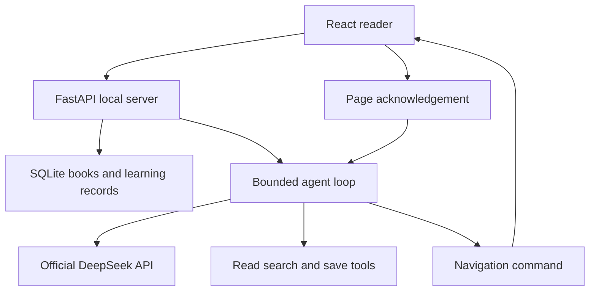

# Architecture / 架构

Each question includes the current section and selection, recent conversation, and the chosen reply language. The model can read a section/chapter, search the book/history, inspect reading state, request navigation, or save an artifact. Sources are scoped to the current book. Navigation waits for the intended client to acknowledge the command; stale commands do not force a new page.

The loop bounds rounds, operations and model wait time. Token accounting is checked after responses, not a strict pre-request cost ceiling. Cancellation preserves already-saved work. Known presentation forms are decoded into ordinary text; malformed responses are not recorded as successful answers. Unknown model formats and unsupported claims can still occur.

The four final expression tools separate a definition, a causal follow-up, a chapter map, and a requested full explanation. Tool results are rendered directly, without another LLM rewrite. This is output organization, not four separate agents or a guarantee of concise/correct answers.

Memory is raw per-book conversation plus keyword retrieval and explicitly saved notes. There is no vector database or autonomous background memory service. Read marks are user actions, not mastery estimates.

每次问题携带当前位置、选区、近期对话与语言。模型按需使用读取、检索、保存和导航工具；导航必须由目标页面确认执行。原始对话保留，派生笔记按需保存；没有长期后台记忆服务。

工具调用、轮次和等待有预算，Token限额是返回后检查，不是严格的请求前费用上限。取消保留已保存产物；格式异常不算成功回答。引用校验与输出组织不保证模型判断正确。
