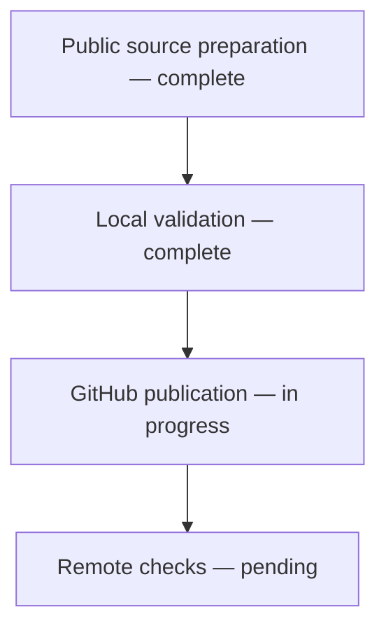
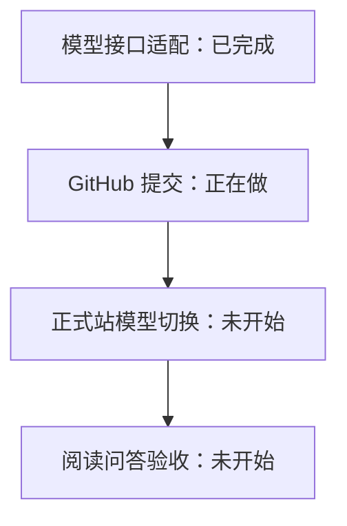

# Release progress

## 2026-11-05 — Local reader and documentation sync

Updated the public reading core, six-format imports, source navigation, scroll turning and bilingual sample material. Kept the README narrative while aligning online/local use and capabilities. Hosted login, verification, OAuth, quotas and production settings are excluded so this repository stays independently runnable.

Validation: 141 backend tests passed, 1 native-tool test skipped; 8 frontend tests and a clean production build passed. Browser verified the direct local reading entry. Real-phone touch and high-load behavior remain unverified. Next: publish and check GitHub CI.

## 2026-11-06 — 模型接口适配完成

现在可配置 DeepSeek、OpenAI 兼容接口和 Claude 原生接口的地址、密钥、模型与思考强度。Claude 工具格式不同，因此增加原生适配，而不是仅替换地址。密钥仅留在服务端。已有 DeepSeek 配置继续有效。

真实 OpenAI 兼容模型已用 Medium 参数完成查目录与工具结果续接；后端 237 项、前端 13 项检查通过，另有 2 项跳过。Claude 目前通过协议模拟测试，尚未做官方账号实测。下一步提交通用代码，然后独立切换线上配置并验收；不更改讲解提示词和已读规则。

