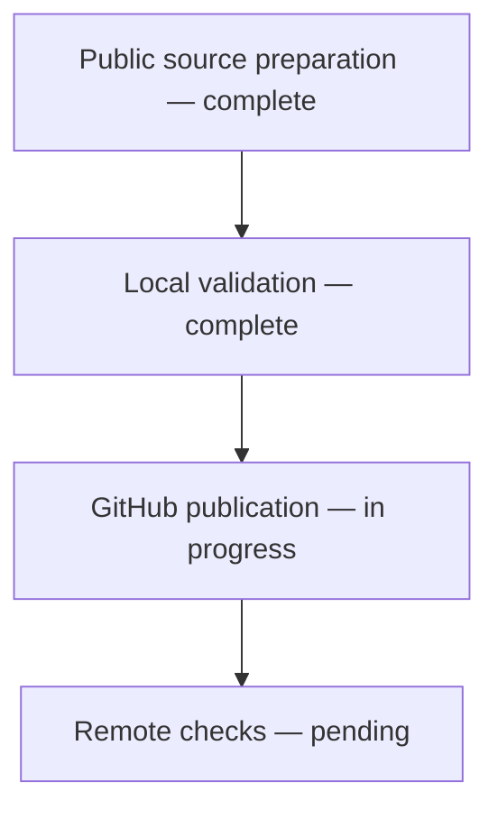
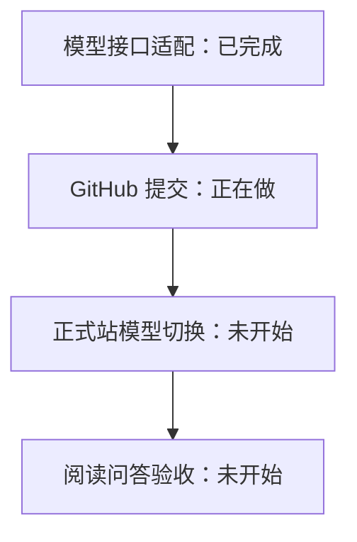
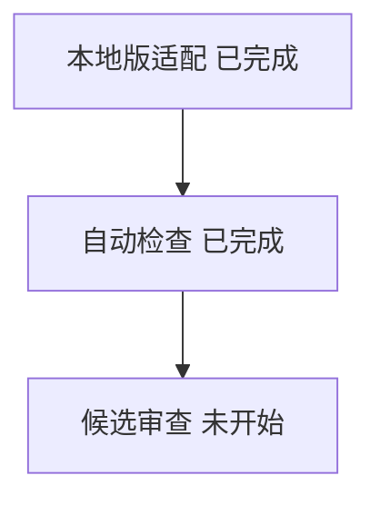
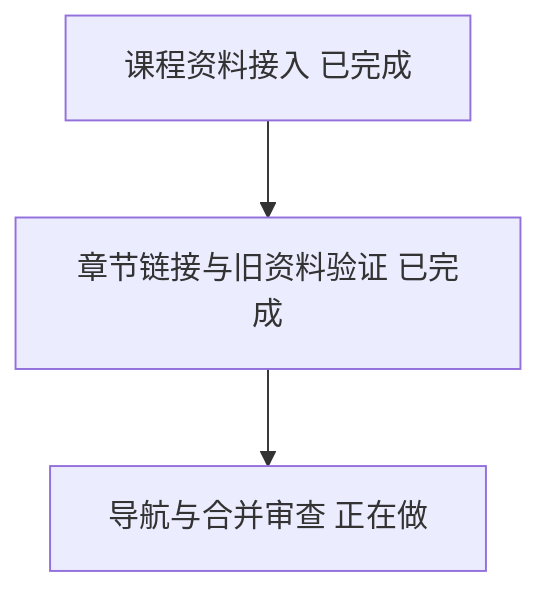
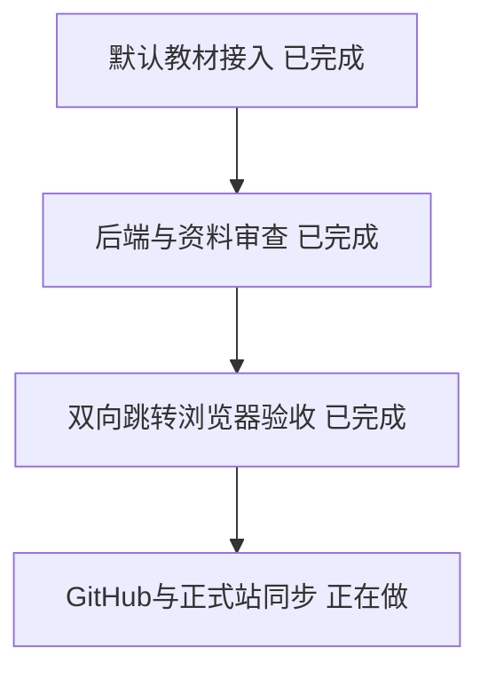

# Release progress

## 2026-11-05 — Local reader and documentation sync

Updated the public reading core, six-format imports, source navigation, scroll turning and bilingual sample material. Kept the README narrative while aligning online/local use and capabilities. Hosted login, verification, OAuth, quotas and production settings are excluded so this repository stays independently runnable.

Validation: 141 backend tests passed, 1 native-tool test skipped; 8 frontend tests and a clean production build passed. Browser verified the direct local reading entry. Real-phone touch and high-load behavior remain unverified. Next: publish and check GitHub CI.

## 2026-11-06 — 模型接口适配完成

现在可配置 DeepSeek、OpenAI 兼容接口和 Claude 原生接口的地址、密钥、模型与思考强度。Claude 工具格式不同，因此增加原生适配，而不是仅替换地址。密钥仅留在服务端。已有 DeepSeek 配置继续有效。

真实 OpenAI 兼容模型已用 Medium 参数完成查目录与工具结果续接；后端 237 项、前端 13 项检查通过，另有 2 项跳过。Claude 目前通过协议模拟测试，尚未做官方账号实测。下一步提交通用代码，然后独立切换线上配置并验收；不更改讲解提示词和已读规则。

### 2026-11-06 — 公开本地版阅读体验候选

这一阶段将通用的回答恢复、连续阅读、笔记定位、理解反馈与 Anki 导出适配到公开本地版，保留原来的首页和中英示例。按文件逐项适配，没有引入账号或试读身份功能；本地反馈保留单次并发、次数和超时限制。

后端 169 项通过、1 项按原有条件跳过，前端 16 项和 Node 24 构建通过。官方 Anki 引擎已在临时集合验证首次导入、重复导入、同卡更新与重开保留；图形界面、来源链接点击和 iPhone/iPad 真机仍未测。下一步交付本地提交供审查，尚不推送或发布。

2026-11-06 — 默认中文课程接入完成

默认阅读资料新增固定版本的CS329Z中文教程，按19讲顺序导入，课程指南和练习另列附录；原文件、代码、公式及来源说明保留。相对章节链接转为同书跳转，旧书和笔记不覆盖。通用加载器不需要账户模块，目录链接指向固定仓库版本；课程未被重新标为MIT。课程、旧资料保留及链接边界检查9项通过；原文已知内容问题与真实模型教学质量尚未验收。下一步进行浏览器前后位置恢复及合并前审查。

## 2026-11-06 — 双向跳转验收完成

后退/前进覆盖目录、引用、上下节和Agent跳转，恢复离开时节内位置，同标签刷新保留；退回后新跳转建立新分支，被动滚动只更新当前位置。沿用现有工具栏样式，不新增导航弹窗。独立浏览器实测延迟请求、连续双后退/前进、重复AI返回、633px段落恢复和刷新、跨书隔离，以及完整课程第1节/140节往返通过。两版前端24项测试与构建通过；构建有本机Node版本与大包已有警告，CI使用Node22维护版继续验证。课程原文保留逐文件hash，唯一上游尾空格不改写；应用改动diff检查干净。PDF位置恢复和真实iPhone/iPad尚未验收；现在同步已验收版本到GitHub与正式站。

