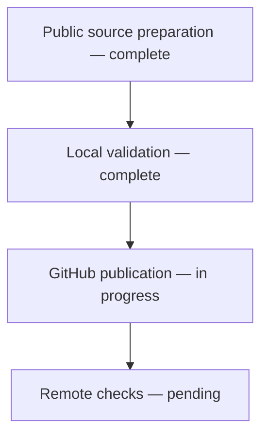

# Release progress

## 2026-11-05 — Local reader and documentation sync

Updated the public reading core, six-format imports, source navigation, scroll turning and bilingual sample material. Kept the README narrative while aligning online/local use and capabilities. Hosted login, verification, OAuth, quotas and production settings are excluded so this repository stays independently runnable.

Validation: 141 backend tests passed, 1 native-tool test skipped; 8 frontend tests and a clean production build passed. Browser verified the direct local reading entry. Real-phone touch and high-load behavior remain unverified. Next: publish and check GitHub CI.

